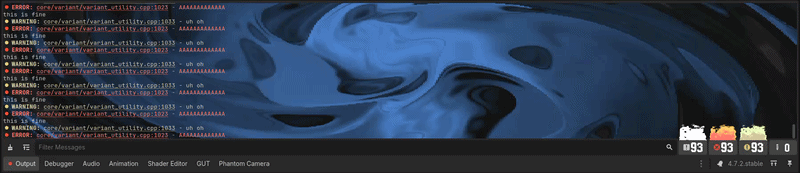

# Balatro Debugger

Balatro. In your console.
Requires Godot 4.7+

Note: The animations only have 10 fps when the editor is in the background. Increase `interface/editor/unfocused_low_processor_mode_sleep_usec` or decrease `interface/editor/low_processor_mode_sleep_usec` in the project settings if that bothers you.
